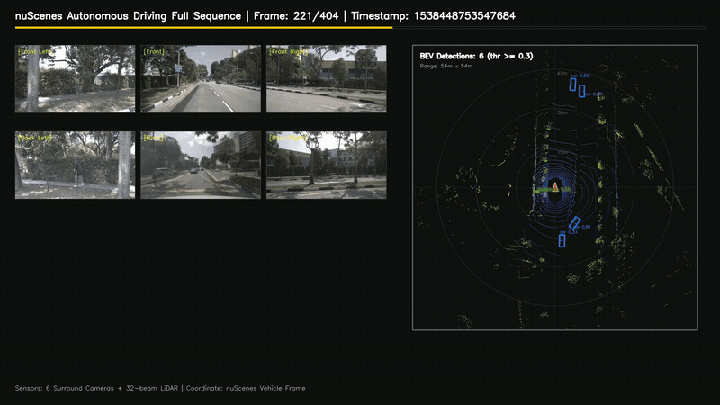
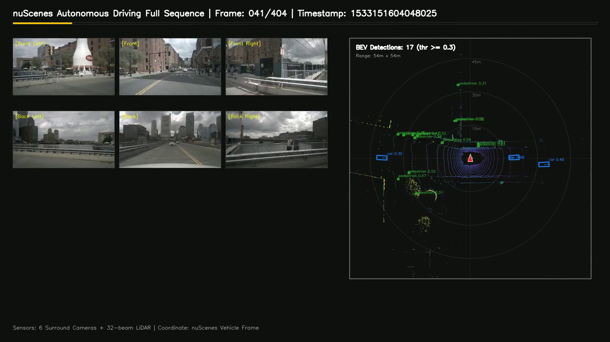
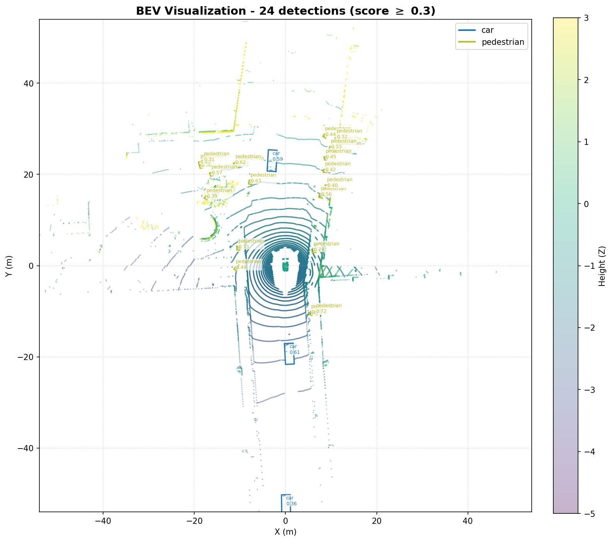

# 3D LiDAR-Based Bird's-Eye View Object Detection via BEVFusion

[](https://www.python.org/)
[](https://pytorch.org/)
[](https://github.com/open-mmlab/mmcv)
[](https://developer.nvidia.com/cuda-toolkit)
[](https://www.nuscenes.org/)
[](notebooks/3D_LiDAR_BEVFusion_MMDetection3D_V2.ipynb)

A dedicated deep learning framework for **3D LiDAR Object Detection** using **BEVFusion** (Bird's-Eye View representation) on the **nuScenes** autonomous driving benchmark. This repository provides end-to-end support for custom CUDA sparse voxelization, model checkpoint conversion (`spconv 1.x` to `2.x`), automated GPU batch inference, and synchronized 360-degree surround camera plus BEV radar visualization pipelines.

---

## Table of Contents

1. [Demo Showcase](#demo-showcase)
2. [Model Architecture](#model-architecture)
3. [Verified Environment Specifications](#verified-environment-specifications)
4. [Google Colab Notebook](#google-colab-notebook)
5. [Quick Start (Local and Colab)](#quick-start-local-and-colab)
6. [nuScenes Mini Full 404-Frame Pipeline](#nuscenes-mini-full-404-frame-pipeline)
7. [Repository Structure](#repository-structure)
8. [Root Directory Scripts Reference](#root-directory-scripts-reference)
9. [Custom Changes and Upstream Patching](#custom-changes-and-upstream-patching)
10. [Troubleshooting and Technical Insights](#troubleshooting-and-technical-insights)
11. [Contributing and Security](#contributing-and-security)
12. [License and Acknowledgments](#license-and-acknowledgments)

---

## Demo Showcase

### 1. Synchronized 360-Degree Surround Vision and 3D BEV Radar (Full 404 Frames)

The dashboard combines **all 6 surround cameras** (Front, Front-Left, Front-Right, Back, Back-Left, Back-Right) with the **Bird's-Eye View (BEV) 3D LiDAR detection map** in real time:

<p align="center">
  
</p>

> **Full Video (1920x1080, 404 frames at 10 FPS, 40.4 seconds):**
> Download or play the full high-resolution demo video directly:
> [**Download Full HD Video (BEVFusion_Demo_Full.mp4)**](assets/BEVFusion_Demo_Full.mp4)

<details>
<summary><b>Click to expand embedded HTML5 Video Player</b></summary>

<video src="assets/BEVFusion_Demo_Full.mp4" controls="controls" width="100%">
  Your browser does not support the video tag.
</video>
</details>

---

### 2. Full Dashboard Poster

A representative frame from the full sequence, showing the six-camera surround layout alongside the BEV detection panel:

<p align="center">
  
</p>

---

### 3. Bird's-Eye View (BEV) Detection Panel

Detailed top-down projection extracted from the demo video, showing the depth-colored LiDAR point cloud, ego vehicle marker, and oriented 3D bounding boxes with class labels and confidence scores:

<p align="center">
  
</p>

---

## Model Architecture

The implemented architecture is the **BEVFusion (LiDAR-Only)** pipeline, optimized for high-accuracy 3D oriented bounding box prediction on point clouds:

```text
[Raw LiDAR Points (x, y, z, r, t)]
       |
       v
 1. Voxelization (0.075m x 0.075m x 0.2m, 1440x1440x41 grid)
       |
       v
 2. BEVFusionSparseEncoder (4-stage 3D Sparse Convolution via spconv 2.x)
       |
       v
 3. SECOND 2D Backbone (Multi-scale BEV spatial convolutions: 128 and 256 channels)
       |
       v
 4. SECONDFPN Neck (Upsampling and concatenation to unified 512-channel BEV map)
       |
       v
 5. TransFusionHead (Transformer decoder with 200 learnable queries and cross-attention)
       |
       v
[3D Bounding Boxes (x, y, z, dx, dy, dz, yaw, score, class)]
```

### Detected Object Classes (nuScenes 10-Class Benchmark)

`car`, `truck`, `construction_vehicle`, `bus`, `trailer`, `barrier`, `motorcycle`, `bicycle`, `pedestrian`, `traffic_cone`.

---

## Verified Environment Specifications

| Component | Verified Specification |
| :--- | :--- |
| **Operating System** | Ubuntu 22.04.4 LTS (Jammy Jellyfish) / Windows 10 or 11 |
| **Python** | 3.10.22 (via Pixi or Conda) |
| **Python Executable (Colab)** | `/content/.pixi/envs/default/bin/python` |
| **CUDA Toolkit** | 11.8 (nvcc V11.8.89) |
| **GPU Hardware** | NVIDIA Tesla T4 (15 GB VRAM) |
| **PyTorch** | `torch==2.1.2+cu118`, `torchvision==0.16.2+cu118`, `torchaudio==2.1.2+cu118` |
| **MMCV** | `mmcv==2.1.0` (prebuilt with CUDA 11.8 and GCC 9.3) |
| **MMEngine** | `mmengine==0.10.7` |
| **MMDetection3D** | `mmdet3d==1.4.0` (`dev-1.x` branch with custom BEVFusion extensions) |
| **Sparse Convolution** | `spconv-cu118` |
| **Numerical Libraries** | `numpy==1.26.4`, `pandas==2.2.2`, `scipy==1.13.1` |

---

## Google Colab Notebook

The complete end-to-end workflow is available as a verified, self-contained notebook:

**[`notebooks/3D_LiDAR_BEVFusion_MMDetection3D_V2.ipynb`](notebooks/3D_LiDAR_BEVFusion_MMDetection3D_V2.ipynb)**

Verified notebook contents:

* **54 cells total**: 43 executable code cells and 11 documentation cells.
* **57 stored outputs**, including environment logs, GPU information, compilation logs, inference results, BEV figures, and video generation output.
* **10 numbered workflow sections**, from Pixi environment initialization through full 404-frame dashboard rendering.
* **Colab-ready** with an NVIDIA Tesla T4 GPU accelerator.
* Clones and operates on `https://github.com/tranphat1506/3D-LiDAR-BEVFusion-MMDetection3D-V2.git`, the canonical repository URL used throughout the notebook.

---

## Quick Start (Local and Colab)

### Step 1: Environment and Dependency Installation

```bash
# 1. Install PyTorch with CUDA 11.8
pip install torch==2.1.2 torchvision==0.16.2 torchaudio==2.1.2 --index-url https://download.pytorch.org/whl/cu118

# 2. Pin NumPy and install project dependencies
pip install numpy==1.26.4 pandas==2.2.2
pip install -r requirements.txt

# 3. Install MMEngine and MMCV 2.1.0 (CUDA 11.8)
pip install mmengine
pip install mmcv==2.1.0 -f https://download.openmmlab.com/mmcv/dist/cu118/torch2.1.0/index.html
```

### Step 2: Set Up MMDetection3D and Compile BEVFusion CUDA Operators

```bash
# 1. Clone upstream mmdetection3d (dev-1.x branch)
mkdir -p external
git clone -b dev-1.x https://github.com/open-mmlab/mmdetection3d.git external/mmdetection3d

# 2. Apply custom patches from custom_changes/
cp -r custom_changes/* external/mmdetection3d/

# 3. Install mmdet3d in development mode
cd external/mmdetection3d && python setup.py develop && cd ../..

# 4. Compile BEVFusion custom CUDA operators (bev_pool, voxel_layer)
cd external/mmdetection3d/projects/BEVFusion && python setup.py develop && cd ../../..
```

### Step 3: Download Pretrained Weights and Fix the Checkpoint

The official OpenMMLab checkpoint was saved with the `spconv 1.x` weight layout. Convert it to the `spconv 2.x` layout before inference:

```bash
# 1. Download official weights
mkdir -p checkpoints/bevfusion_lidar
wget -O checkpoints/bevfusion_lidar/bevfusion_lidar_voxel0075_second_secfpn_8xb4-cyclic-20e_nus-3d-2628f933.pth \
  https://download.openmmlab.com/mmdetection3d/v1.1.0_models/bevfusion/bevfusion_lidar_voxel0075_second_secfpn_8xb4-cyclic-20e_nus-3d-2628f933.pth

# 2. Transpose tensor dimensions
python fix_bevfusion_checkpoint.py \
  --input checkpoints/bevfusion_lidar/bevfusion_lidar_voxel0075_second_secfpn_8xb4-cyclic-20e_nus-3d-2628f933.pth \
  --output checkpoints/bevfusion_lidar/bevfusion_lidar_voxel0075_second_secfpn_8xb4-cyclic-20e_nus-3d-2628f933_fixed.pth
```

### Step 4: Run the Quick 10-Frame Demo and Visualize

```bash
# Run BEVFusion on 10 sample LiDAR frames (outputs saved to demo/outputs/preds/)
python setup_demo.py

# Render top-down BEV 2D visualizations (outputs saved to demo/outputs/vis/)
python visualize_demo.py
```

---

## nuScenes Mini Full 404-Frame Pipeline

To process continuous sequences and generate complete multi-camera and BEV radar animations:

### 1. Download and Unpack nuScenes Mini (approximately 1.7 GB)

```bash
mkdir -p data/nuscenes
wget -c https://www.nuscenes.org/data/v1.0-mini.tgz -P data/
tar -xzf data/v1.0-mini.tgz -C data/nuscenes
```

### 2. High-Throughput GPU Inference on All 404 Frames (approximately 60 seconds on a Tesla T4)

```bash
python run_inference_all.py
```

Processes all 404 LiDAR frames, exports predictions to `demo/outputs/preds/` with automatic fault tolerance, and resumes from already processed frames.

### 3. Generate the Full HD (1080p) Synchronized Dashboard Video

```bash
python create_full_nuscenes_video.py
```

Renders a 1920x1080 video with all six surround cameras on the left and the dynamic 3D BEV LiDAR radar map on the right, saved at `demo/outputs/full_video/nuscenes_full_360_bev.mp4`.

### 4. Generate the 360-Degree Surround and BEV Animated GIF

```bash
python visualize_nuscenes_mini_gif.py
```

Outputs the animated sequence to `demo/outputs/nuscenes_mini_gif/nuscenes_360_surround_bev_animation.gif`.

---

## Repository Structure

```text
.
├── assets/                            # Demo media for showcase and documentation
│   ├── BEVFusion_Demo_Full.mp4        # Full HD 1080p demo video (404 frames at 10 FPS)
│   ├── demo_preview.gif               # Animated dashboard preview GIF
│   ├── demo_dashboard_poster.png      # 360-degree surround and BEV dashboard frame
│   └── bev_visualization_sample.png   # BEV detection panel extracted from the demo video
├── notebooks/
│   └── 3D_LiDAR_BEVFusion_MMDetection3D_V2.ipynb  # Verified Colab notebook (54 cells, 57 outputs)
├── custom_changes/                    # Upstream overrides ensuring exact reproducibility
│   ├── README.md                      # Explanation of every custom patch
│   ├── configs/                       # BEVFusion nuScenes 3D detection config
│   ├── projects/BEVFusion/setup.py    # Custom CUDA compilation script
│   ├── mmdet3d/                       # Evaluation metric, inferencer, and import patches
│   └── tools/dataset_converters/      # nuScenes converter and ground-truth database patches
├── data/
│   ├── nuscenes/                      # nuScenes Mini dataset (created after download)
│   └── nuscenes_demo/                 # Standalone six-camera demo sample
├── demo/                              # 10 default sample LiDAR frames (.bin)
├── scripts/
│   ├── visualize_bev.py               # Standalone BEV point cloud and box renderer
│   └── open3d_view_saved_ply.py       # Interactive Open3D viewer for exported PLY artifacts
├── .github/                           # Issue forms and pull request template
├── fix_bevfusion_checkpoint.py        # spconv 1.x to 2.x tensor weight layout fixer
├── bev_inferencer.py                  # Core CLI 3D detection inference engine
├── mmdet3d_inference2.py              # Backward-compatibility wrapper around bev_inferencer.py
├── 3d_lidar_bevfusion_mmdetection3d_v2.py  # Local inference entry point (syntax-checked only)
├── setup_demo.py                      # Cross-platform 10-sample inference pipeline
├── run_inference_all.py               # GPU batch inference runner for all 404 frames
├── visualize_demo.py                  # Top-down BEV rendering pipeline
├── visualize_nuscenes_mini_gif.py     # 360-degree surround vision and BEV animated GIF generator
├── create_full_nuscenes_video.py      # Full HD 1080p synchronized dashboard video creator
├── requirements.txt                   # Python package dependencies
├── CONTRIBUTING.md                    # Contribution guidelines
├── SECURITY.md                        # Security policy
├── AGENT.md                           # Core agent development directives (under 200 words)
├── CLAUDE.md                          # Comprehensive developer workflow reference
└── README.md                          # Project documentation
```

---

## Root Directory Scripts Reference

The root directory contains dedicated, standalone scripts designed for specific execution, conversion, and visualization phases:

| Script | Purpose and Key Functionality | Primary Outputs |
| :--- | :--- | :--- |
| `setup_demo.py` | Automated quick-demo pipeline for 10 sample LiDAR frames. Features relative path resolution, automatic GPU or CPU detection, and a self-healing fallback against inferencer postprocessing errors. | `demo/outputs/preds/*.json` |
| `run_inference_all.py` | High-throughput GPU inference engine for all 404 keyframes of nuScenes Mini. Incorporates Windows CUDA DLL loaders, resume capability (skips already computed frames), and per-frame fault tolerance. | `demo/outputs/preds/<frame>.json` (404 files) |
| `visualize_demo.py` | Renders individual 2D top-down BEV figures with Viridis elevation-colored point clouds and rotated bounding box polygons with class labels and confidence scores. The Matplotlib Agg backend prevents headless display errors. | `demo/outputs/vis/*.png` |
| `create_full_nuscenes_video.py` | High-performance video creation engine using pure OpenCV drawing and NumPy array slicing. Synchronizes all six surround cameras with the BEV radar map in RFU coordinates and encodes via ffmpeg H.264. | `demo/outputs/full_video/nuscenes_full_360_bev.mp4` |
| `visualize_nuscenes_mini_gif.py` | Multi-panel dashboard generator arranging six surround cameras (three front, three back) alongside a large BEV detection panel. Automatically compiles multi-frame sequences into an animated GIF. | `demo/outputs/nuscenes_mini_gif/*.gif` |
| `fix_bevfusion_checkpoint.py` | Fixes tensor layout mismatch between `spconv 1.x` (`[out_ch, D, H, W, in_ch]`) and `spconv 2.x` (`[D, H, W, in_ch, out_ch]`) via `weight.permute(1, 2, 3, 4, 0).contiguous()`. | `*_fixed.pth` |
| `bev_inferencer.py` | Comprehensive command-line diagnostic tool supporting multi-modality (LiDAR, monocular, multi-modal), Open3D 3D point cloud and bounding box artifact exports (`.ply`), and 2D camera projections. | Predictions, `.ply` models, 2D projections |
| `3d_lidar_bevfusion_mmdetection3d_v2.py` | Local-machine BEVFusion inference entry point. Accepts a single point cloud or a directory, auto-detects config, checkpoint, and device, and writes inference JSON plus optional BEV PNGs. No Colab dependencies. **Syntax-checked only; runtime inference has not been validated.** | `demo/outputs/preds/*.json`, `demo/outputs/vis/*.png` |
| `scripts/visualize_bev.py` | Standalone BEV renderer that auto-detects point cloud channel layouts (nuScenes 5D and generic 4D binary formats) and draws top-down point clouds with prediction boxes. | BEV images |
| `scripts/open3d_view_saved_ply.py` | Interactive Open3D viewer for PLY point clouds, axes, predicted boxes, labels, and ground-truth boxes exported by the inferencer. | Interactive 3D window or screenshot |

> **Note:** `3d_lidar_bevfusion_mmdetection3d_v2.py` is a newly added local inference entry point. It has only been syntax-checked with `python3 -m py_compile` and AST parsing. It has not been runtime-tested against a complete MMDetection3D environment, so validate it before relying on its predictions.

---

## Custom Changes and Upstream Patching

The `custom_changes/` directory mirrors modifications applied to `external/mmdetection3d/` to resolve critical upstream bugs, compiler incompatibilities, and dataset evaluation constraints. See [`custom_changes/README.md`](custom_changes/README.md) for the full patch catalog.

### 1. `custom_changes/mmdet3d/` (Core Framework Patches)

* **`mmdet3d/__init__.py` (Bypass Strict MMCV Version Assert):**
  * *Problem*: The upstream code asserts `mmcv_version < '2.2.0'`. Prebuilt wheels with custom CUDA build tags such as `2.1.0+cu118` fail this string comparison, raising `AssertionError: MMCV is used but incompatible` and halting imports.
  * *Solution*: Disabled the strict version assertion to allow verified MMCV 2.1.0 builds to import seamlessly.

* **`mmdet3d/apis/inferencers/base_3d_inferencer.py` (GPU Memory and File Naming Fix):**
  * *Problem*: Attempting to convert GPU bounding box tensors directly via `.numpy().tolist()` without `.cpu()` causes a PyTorch runtime error. The default postprocessing also lacks automatic output naming based on raw LiDAR sweep filenames.
  * *Solution*: Added explicit `.cpu()` tensor transfers (`pred_instances_3d.bboxes_3d.tensor.cpu().tolist()`) and automated filename extraction so prediction results are saved cleanly to `osp.join(pred_out_dir, 'preds', lidar_path + '.json')`.

* **`mmdet3d/evaluation/metrics/nuscenes_metric.py` (Partial Dataset Evaluation Patch):**
  * *Problem*: The official `NuScenesEval` module strictly enforces `assert set(pred_boxes.sample_tokens) == set(gt_boxes.sample_tokens)`, assuming the entire multi-gigabyte dataset is being evaluated. When evaluating subsets such as nuScenes Mini or selected sample frames, this assertion crashes the evaluation process.
  * *Solution*: Monkeypatched `NuScenesEval.__init__` to dynamically filter ground truth annotations, loading only the tokens that correspond to the samples actually predicted (`pred_tokens`). This enables smooth mAP and NDS metric computation on subset evaluations.

### 2. `custom_changes/projects/BEVFusion/` (CUDA Compilation Fixes)

* **`projects/BEVFusion/setup.py` (NVCC Compiler Compatibility):**
  * *Problem*: When compiling BEVFusion custom CUDA kernels (`bev_pool`, `voxel_layer`) on modern Linux distributions (Ubuntu 22.04 with GCC 11, 12, or 14) or Windows (MSVC), NVCC 11.8 fails with `fatal error: unsupported compiler`.
  * *Solution*: Injected compilation flags into `extra_compile_args['nvcc']`:
    * `-allow-unsupported-compiler` and `-D_ALLOW_COMPILER_AND_STL_VERSION_MISMATCH` to override compiler version checks.
    * Explicit GPU architecture targets: `sm_70`, `sm_75` (NVIDIA Tesla T4 on Colab), `sm_80` (A100), and `sm_86` (RTX 30 series).

### 3. `custom_changes/configs/` (BEVFusion Model Tuning)

* **`bevfusion_lidar_voxel0075_second_secfpn_8xb4-cyclic-20e_nus-3d.py`:**
  * *Local Checkpoint Loading*: Configured `load_from = 'checkpoints/bevfusion_lidar/..._fixed.pth'` to eliminate external HTTP download dependencies during inference.
  * *Offline Storage*: Disabled the internal `petrel` S3 storage backend by setting `backend_args = None`, ensuring point clouds are read from local disk paths.
  * *Modality Isolation*: Enforced pure LiDAR processing (`use_lidar=True, use_camera=False`).
  * *Optimized Learning Rate*: Reduced the learning rate to `lr = 0.0001` for stable transfer learning and fine-tuning without gradient divergence.

---

## Troubleshooting and Technical Insights

### 1. Checkpoint Size Mismatch (spconv 1.x vs spconv 2.x)

* **Problem**: The official checkpoint throws `RuntimeError: size mismatch for pts_middle_encoder...`.
* **Cause**: `spconv 1.x` uses layout `[out_ch, D, H, W, in_ch]`, while modern `spconv 2.x` expects `[D, H, W, in_ch, out_ch]`.
* **Fix**: Run `python fix_bevfusion_checkpoint.py`, which executes `weight.permute(1, 2, 3, 4, 0).contiguous()`.

### 2. Missing `external/` Directory

* **Problem**: Cloning the repository does not include `external/mmdetection3d/`.
* **Cause**: `external/` is git-ignored due to size.
* **Fix**: Clone `mmdetection3d` (`-b dev-1.x`) into `external/mmdetection3d` and copy all patches from `custom_changes/`.

### 3. Linux Dynamic Linker Conflict (CXXABI_1.3.15 not found)

* **Problem**: In Colab or Pixi environments, a `libstdc++.so.6` version mismatch occurs.
* **Fix**: Link the Pixi environment's newer library into the system path:
  ```bash
  cp /content/.pixi/envs/default/lib/libstdc++.so.6 /usr/lib/x86_64-linux-gnu/libstdc++.so.6
  ```

### 4. Coordinate System Alignment (Ego-Centric RFU)

* **Convention**: nuScenes uses the RFU convention:
  * **X**: Right (lateral)
  * **Y**: Forward (longitudinal direction of travel)
  * **Z**: Up
* **BEV Projection**: The vehicle is pinned at the origin `(cx, cy)` with heading straight up (`v = cy - Y * scale`). The open road ahead extends upward, and parked vehicles lie along the left (`X < 0`) and right (`X > 0`) curbs.

---

## Contributing and Security

* Read [`CONTRIBUTING.md`](CONTRIBUTING.md) for the fork-and-pull-request workflow, branch naming, commit conventions, coding guidelines, and manual validation steps.
* Use the issue forms in [`.github/ISSUE_TEMPLATE/`](.github/ISSUE_TEMPLATE/) for bug reports and feature requests.
* Report security vulnerabilities privately according to [`SECURITY.md`](SECURITY.md). Do not disclose vulnerabilities in public issues.

---

## License and Acknowledgments

Built upon [MMDetection3D](https://github.com/open-mmlab/mmdetection3d) and [BEVFusion](https://github.com/mit-han-lab/bevfusion). Uses the [nuScenes](https://www.nuscenes.org/) dataset.
